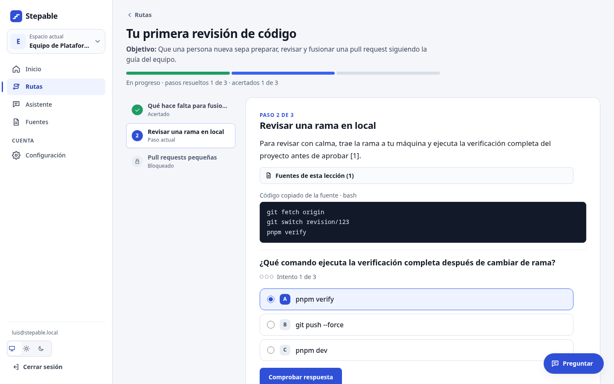
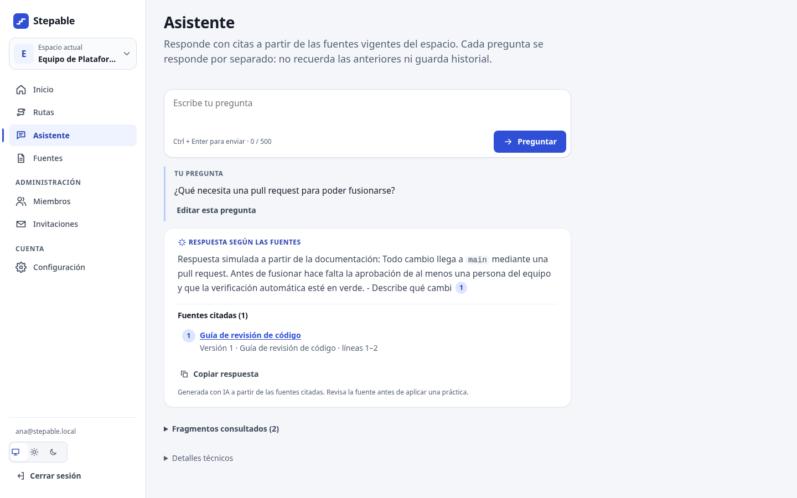
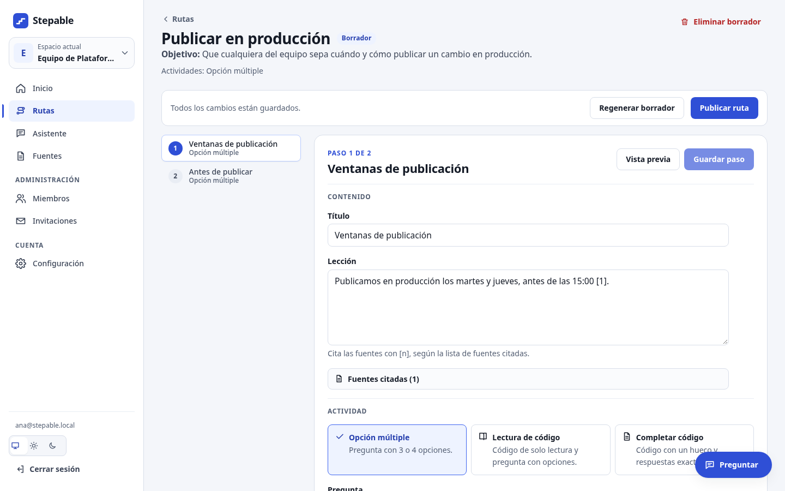
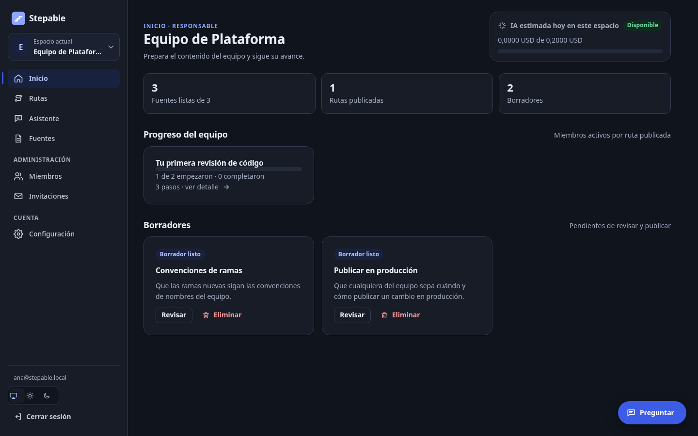
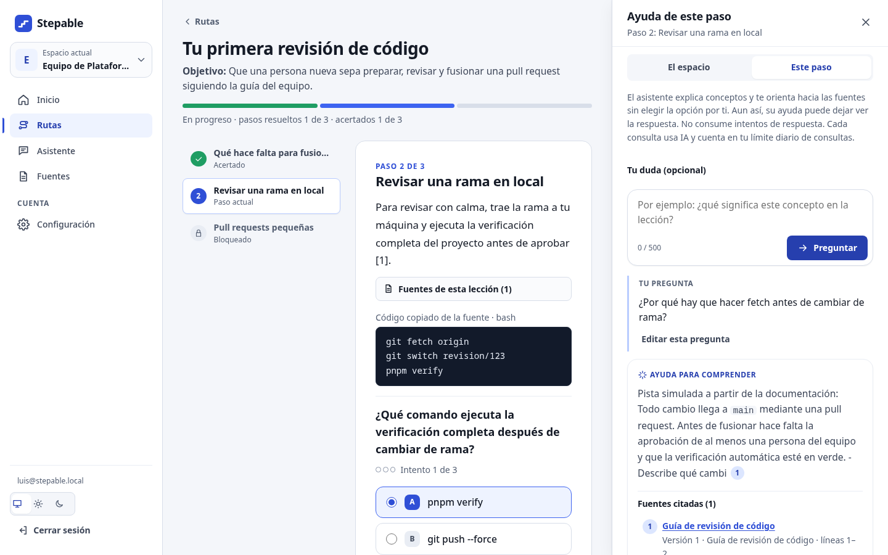

<div align="center">

# Stepable

**Onboarding interactivo para equipos de software, creado a partir de su propia documentación.**




</div>

Stepable convierte las guías, convenciones y procesos de un equipo en **rutas de aprendizaje con ejercicios**, y añade un **asistente que responde citando la documentación**. La IA propone; una persona responsable revisa antes de publicar.

## Funciones

- **Rutas generadas con IA**: a partir de un objetivo y de las fuentes elegidas, con lecciones citadas y tres tipos de actividad: opción múltiple, lectura de código y completar código.
- **Revisión humana**: editor por pasos, vista previa y publicación explícita. Sin evidencia suficiente, no se inventa contenido.
- **Aprendizaje guiado**: un paso a la vez, intentos limitados, retroalimentación inmediata y progreso del equipo.
- **Asistente con citas verificadas**: búsqueda híbrida (texto y embeddings) solo en las fuentes del espacio. Una cita que no corresponde a un fragmento recuperado se descarta.
- **Ayuda en cada paso**: orienta sin revelar la respuesta y la explica una vez resuelto.
- **Equipos y permisos**: espacios, roles, invitaciones por correo y auditoría de cambios de acceso.
- **Control de consumo de IA**: límites diarios y acumulados aplicados antes de cada llamada.
- **Interfaz cuidada**: modo claro y oscuro, diseño adaptado a móvil, navegación por teclado y movimiento reducido.

<table>
  <tr>
    <td width="50%"><br><sub><b>Asistente:</b> respuestas con citas a las fuentes del espacio (en la captura, el modelo simulado de las pruebas).</sub></td>
    <td width="50%"><br><sub><b>Editor:</b> la persona responsable revisa el borrador antes de publicarlo.</sub></td>
  </tr>
  <tr>
    <td width="50%"><br><sub><b>Inicio del responsable</b> en modo oscuro.</sub></td>
    <td width="50%"><br><sub><b>Ayuda de un paso</b> en el panel lateral, sin salir de la lección (modelo simulado).</sub></td>
  </tr>
</table>

## Tecnologías

**Next.js 16** (App Router y Server Actions) · **React 19** · **TypeScript** · **PostgreSQL** con **Drizzle ORM** y **pgvector** · **Supabase** (Auth y Storage) · **pg-boss** para trabajos en segundo plano · **OpenAI** mediante adaptadores intercambiables · **Motion** · **Vitest** y **Playwright**

La arquitectura es un monolito modular: reglas de negocio en `src/modules`, infraestructura en `src/adapters` y un worker aparte para procesar documentos y generar rutas.

## Arranque rápido

Requisitos: Node.js 24, pnpm 11, Docker y [Supabase CLI](https://supabase.com/docs/guides/cli).

```bash
pnpm install --frozen-lockfile
pnpm env:start                 # PostgreSQL, Auth, Storage y Mailpit en local
pnpm db:migrate
pnpm auth:create-local-user    # tu usuario
pnpm access:bootstrap-space    # tu primer espacio
pnpm dev                       # http://127.0.0.1:3000  (y pnpm worker en otra terminal)
```

Configuración de IA, pruebas y más detalles en la [guía de desarrollo local](docs/12-desarrollo-local.md).

## Estado

Prototipo funcional que se ejecuta **en local con documentos sintéticos**: no está desplegado ni validado todavía con un equipo real. La especificación, las reglas de negocio y las decisiones de diseño (ADR) están en [`docs/`](docs/00-indice.md).

---

<div align="center">
<sub>Desarrollado por <a href="https://github.com/cesar-programmer">César Córdova</a>, con apoyo de asistentes de IA para programar.</sub>
</div>
