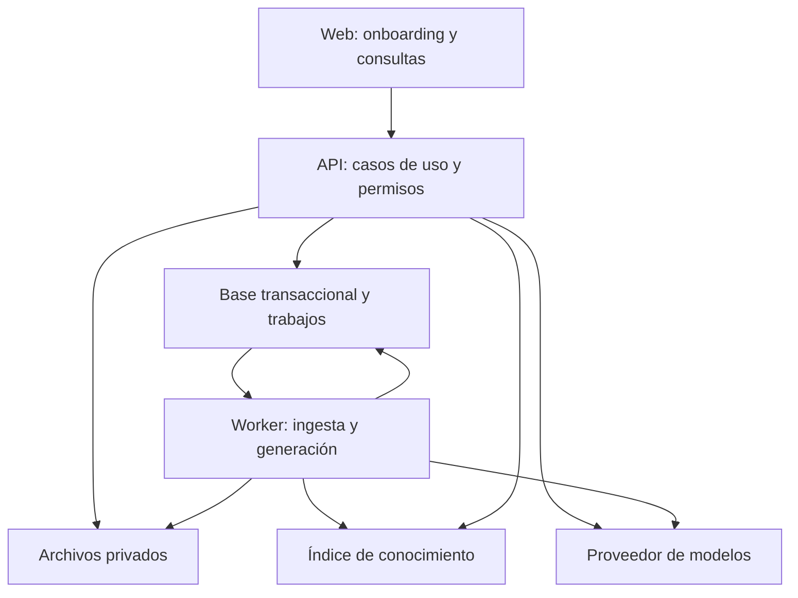
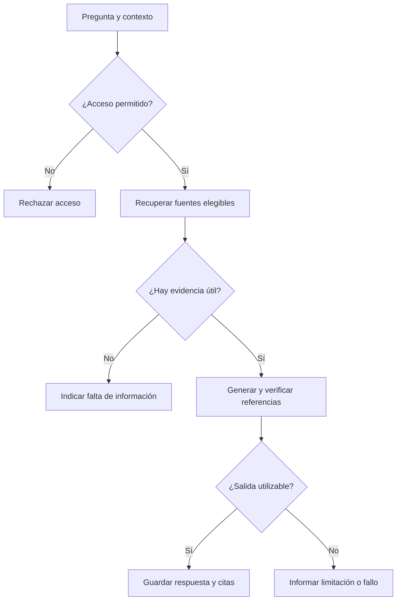

# Arquitectura inicial de Stepable V0

Estado: arquitectura y ciclo local de acceso aprobados e implementados y cerrados localmente en E1.7; servicios externos y piloto pendientes. Versión v1.2.
Actualizado: 2026-09-21 · Decisiones relacionadas: [ADR-002](decisiones/ADR-002-organizacion-modular.md) y [ADR-003](decisiones/ADR-003-stack-y-acceso-e1.md).

## 1. Objetivo y fundamento

Proponemos una aplicación organizada por módulos, con una API y un proceso de trabajo en segundo plano que comparten código de negocio. La web es su interfaz inicial. Los módulos no se despliegan como servicios independientes: API y worker son dos formas de ejecutar una misma aplicación backend.

Esta organización fue aceptada para desarrollo local el 2026-09-17, basada en un desarrollador, un piloto todavía no confirmado y la necesidad de mantener reglas coherentes entre fuentes, rutas y progreso. No es una conclusión de validación comercial o de rendimiento.

Separar responsabilidades lógicas no exige separar servidores. Microsoft documenta esta distinción y el aislamiento de reglas respecto a infraestructura; se utiliza como referencia conceptual, sin elegir .NET o Azure. [Microsoft: arquitecturas web](https://learn.microsoft.com/en-us/dotnet/architecture/modern-web-apps-azure/common-web-application-architectures).

## 2. Componentes en ejecución

Las flechas representan acceso o dependencia operativa, no eventos emitidos automáticamente por la base. El worker reclama trabajos persistidos mediante un mecanismo por elegir. El índice puede estar en la misma base o en almacenamiento especializado; el dibujo no prescribe otro servidor.

| Componente | Responsabilidad | Límite |
| --- | --- | --- |
| Web | Pantallas, formularios, progreso y chat | No decide permisos ni guarda claves de proveedores |
| API | Autorización, casos de uso, consultas y guardado de resultados | No procesa documentos largos dentro de una solicitud |
| Worker | Extraer, indexar y generar borradores | Reutiliza reglas del backend y revalida vigencia del trabajo |
| Base transaccional | Estado del negocio, miembros, versiones, intentos y trabajos | Fuente de verdad de permisos y publicación |
| Archivos privados | Originales y versiones de documentos | Acceso autorizado, no enlaces públicos permanentes |
| Índice | Encontrar fragmentos candidatos | No es autoridad de permisos ni copia única del conocimiento |
| Modelos | Embeddings y generación de contenido | No publican rutas ni autorizan operaciones |

Web/API comparten la aplicación Next.js durante E1 y el worker se incorpora desde E2. Para desarrollo local se usa Supabase Auth; su uso alojado y la infraestructura del piloto no están decididos. No se contratan servicios.

## 3. Módulos y propiedad

| Módulo | Es propietario de | Interacciones permitidas |
| --- | --- | --- |
| Acceso | Espacios, membresías y roles | Expone comprobaciones de acceso a todos los casos de uso |
| Fuentes | Documentos, versiones, texto y fragmentos | Expone versiones elegibles y ubicaciones de citas |
| Conocimiento | Recuperación, integración con modelos y validación de salida | Consulta fuentes autorizadas; devuelve resultados, no publica |
| Rutas | Borradores, pasos y versiones publicadas | Solicita generación a conocimiento y valida referencias de fuentes |
| Aprendizaje | Intentos, calificaciones y progreso | Lee una versión publicada y sus criterios |
| Conversaciones | Hilos y mensajes privados | Solicita respuestas a conocimiento con contexto autorizado |
| Operación | Trabajos, consumo y diagnóstico | Coordina ejecución; no contiene reglas de aprendizaje |

Cada módulo modifica sus propios datos. Los casos de uso coordinan colaboraciones mediante funciones o interfaces internas explícitas. No usar llamadas HTTP entre módulos del mismo backend ni permitir que uno modifique tablas de otro como atajo.

## 4. Organización interna del código

La estructura física se decidirá al elegir lenguaje. Dentro de una funcionalidad se distinguirán:

- Entrada: endpoint o manejador de trabajo que valida forma de la solicitud.
- Caso de uso: autoriza y coordina la operación, por ejemplo publicar una ruta.
- Reglas: condiciones como inmutabilidad de versión publicada o pertenencia al espacio.
- Adaptadores: base de datos, archivos, correo, extracción y modelos.

No se requiere una interfaz por cada clase. Se crean fronteras explícitas donde hay efectos externos o reglas que interesa verificar de forma independiente. La interfaz web no importa detalles del proveedor de IA y el worker no duplica reglas de publicación.

## 5. Fuentes y procesamiento

Flujo propuesto:

1. La API autoriza al responsable, valida tipo y límite del archivo y registra la carga.
2. Guarda el archivo privado. Una vez confirmado, persiste versión y trabajo pendiente. Un fallo entre almacenamiento y registro requiere limpieza de cargas huérfanas; no se presume transacción distribuida.
3. El worker reclama el trabajo, verifica que la fuente no esté retirada y extrae texto con página o sección.
4. Genera fragmentos y embeddings; escribe resultados bajo una versión de indexación identificable.
5. Solo al completar el procesamiento marca la versión como lista. Las consultas descartan índices incompletos o referencias no elegibles.
6. Si falla, conserva un estado de error recuperable. Un reintento no crea otra versión documental por accidente.

Concreción de E2 en §19. Estados de trabajo propuestos: pendiente, ejecutando, completado, fallido. La elegibilidad documental es separada: una tarea completada no hace vigente una fuente retirada. Límites de intentos y cancelación quedan en PEN-08/PEN-04.

El mecanismo de trabajos debe recuperar una ejecución interrumpida, por ejemplo mediante una reserva con vencimiento. Su contrato debe tolerar procesamiento repetido: registrar el resultado una sola vez por trabajo lógico, aunque el proveedor externo pudiera haber cobrado más de un intento.

## 6. Consulta con evidencia

El identificador de espacio enviado por el navegador no prueba pertenencia. Se verifica usuario, espacio, hilo y, si existe, versión de lección. La búsqueda filtra por espacio y elegibilidad antes de enviar fragmentos al modelo; las referencias se comprueban nuevamente contra las fuentes autorizadas.

La comprobación estructural de citas y la revisión de respaldo son controles distintos. No se garantiza verdad por pasar una validación de formato. El conjunto de evaluación del [documento 06](06-ia-y-evaluacion.md) debe medir respaldo y suficiencia.

Por V0, chat y generación de rutas son operaciones explícitas en la interfaz. No necesitamos un agente autónomo que adivine si debe generar una ruta a partir de cualquier mensaje. Los conectores MCP no son una dependencia del chat.

## 7. Generar, revisar y publicar

1. El responsable elige objetivo, fuentes y actividades.
2. La API registra el trabajo con las versiones seleccionadas. No sostiene una transacción abierta mientras espera al modelo.
3. El worker recupera material elegible y pide un borrador estructurado.
4. Valida tipos de actividad, campos y referencias; guarda un borrador con su procedencia.
5. El responsable revisa y edita contenido, respuestas y explicaciones.
6. La API comprueba rol, versión editada y referencias antes de publicar. Un conflicto de edición se informa en lugar de sobrescribir cambios.

La publicación crea una versión estable. El modelo no recibe credenciales que le permitan publicarla. Cambios de fuente durante una generación deben detectarse: propuesta inicial, conservar el borrador con advertencia y exigir revisión antes de publicar. Esta política se debe cerrar en PEN-04.

## 8. Aprendizaje y calificación

El backend entrega la actividad sin revelar la clave antes de responder. Al enviar una respuesta, valida pertenencia, versión y criterio; guarda intento y progreso de forma coherente. Un doble envío de la misma acción debe devolver el mismo resultado, no contar como dos intentos.

La clave y la explicación se entregan cuando corresponda al feedback. Ocultarlas en el frontend no sustituye este control. La lógica de aprobación se resuelve en PEN-03. La IA puede explicar una regla; no ejecuta código ni redefine criterios durante la calificación.

## 9. Almacenamiento y versiones

Propuesta: una base relacional para el estado principal, almacenamiento privado para archivos y un índice reconstruible desde texto/versiones conservados. El motor y la ubicación del índice están pendientes. No elegir una base vectorial independiente hasta evaluar si la persistencia principal cubre el piloto.

Referencias persistentes deben incluir espacio, fuente, versión y ubicación; rutas e intentos mantienen versiones explícitas. La política de qué versión usa el chat frente a una lección antigua queda pendiente: no hacer mezclas silenciosas.

Bases, archivos y versiones requieren un plan de copia y restauración antes de recibir documentación real del piloto. No se han definido retención ni garantías de recuperación.

## 10. Permisos y límites de confianza

Controlar acceso en cada operación y denegar cuando no exista permiso explícito es la referencia de diseño; esconder botones no autoriza recursos. [OWASP: Authorization](https://cheatsheetseries.owasp.org/cheatsheets/Authorization_Cheat_Sheet.html).

Aplicar controles también a descarga de fuentes, citas, historial y tareas en segundo plano. No enviar documentos de otro espacio al modelo para después ocultarlos en pantalla. Contenido recuperado se trata como datos, no como instrucciones de sistema, y se evita que pueda activar acciones privilegiadas. [OWASP: seguridad de RAG](https://cheatsheetseries.owasp.org/cheatsheets/RAG_Security_Cheat_Sheet.html).

Chats privados se rigen por RN-04. Registros operativos guardan por defecto identificadores, duración, resultado y consumo, no prompts o documentos completos. Definir acceso operativo, retención y proveedor antes del piloto. Renderizar Markdown generado con restricciones para impedir contenido activo no deseado.

## 11. Fallos, consumo y observabilidad

| Caso | Respuesta prevista |
| --- | --- |
| Parser o embeddings fallan | Fuente no elegible, error visible y reintento acotado |
| Worker reinicia | Recuperar trabajos abandonados sin duplicar el resultado lógico |
| Modelo no responde | Estado de error y mensaje claro; no inventar una respuesta |
| Fuentes cambian | Detectar versiones y aplicar política PEN-04 |
| Dos editores guardan | Detectar conflicto de versión |
| Límite de IA alcanzado | Rechazar nuevas operaciones costosas con explicación |
| Usuario pierde acceso | Revalidar operaciones siguientes y entrega de resultados |

Reservar consumo estimado antes de llamadas concurrentes y reconciliarlo con el uso reportado evita que varias solicitudes ignoren el mismo límite. Los valores y la política ante timeouts requieren definición; no se promete un tope exacto de facturación externa por esta reserva.

Correlacionar solicitud, trabajo y llamada de proveedor. Registrar intentos, errores y uso; medir latencia antes de prometer umbrales. No se necesita fijar todavía una plataforma completa de observabilidad.

## 12. Alternativas y evolución

| Alternativa | Evaluación para Stepable |
| --- | --- |
| Toda la operación dentro de solicitudes web | Menos procesos, pero ingesta/generación largas requieren recuperación fuera de la solicitud |
| Aplicación modular y worker del mismo backend | Propuesta base: reglas compartidas y trabajos persistentes con responsabilidades delimitadas |
| Microservicios por módulo | Añade coordinación distribuida y despliegues que el piloto aún no justifica |

La separación propuesta permite agregar tipos de actividad y adaptadores de fuentes más adelante. No garantiza que futuras integraciones sean triviales: permisos y sincronización requerirán diseño propio. Separar un servicio solo cuando haya evidencia de escala, carga o mantenimiento que lo justifique.

## 13. Qué queda para resolver

ADR-002 y el ciclo local de acceso de ADR-003 están aceptados hasta E1.7. PEN-02/RN-18 conserva el endurecimiento externo antes del piloto; PEN-07 conserva jobs, búsqueda, IA y servicios alojados; PEN-01 requiere precisar la operación/costo del piloto. PEN-04/PEN-06/PEN-08 cubren versiones, privacidad y límites antes de las entregas afectadas.

E1.1 fue autorizada, implementada y verificada localmente. Su aprobación no autorizaba por sí sola E1.2; la identidad local recibió autorización separada después. Ninguna de ambas autoriza despliegue o gastos.

## 14. Restricción económica incorporada en v0.3

Presupuesto indicado por el usuario: aproximadamente 10 USD mensuales para primeras pruebas, entendido como total al responder la pregunta sobre presupuesto mensual. No presupone cargos autorizados.

Propuesta de planificación: validar primero los flujos localmente y estimar por separado el piloto accesible a terceros. En local, registrar consumo de embeddings y generación si se usan APIs de pago; los recursos propios también tienen costos como electricidad, aunque no impliquen contratar hosting. No suponer que alojamiento, almacenamiento, correo e IA cabrán todos en 10 USD sin comparar precios y límites vigentes.

Antes de seleccionar proveedores: definir una carga de prueba (documentos, tamaño, preguntas y rutas), calcular consumo aproximado, verificar precios oficiales y reservar margen. Usar respuestas simuladas para desarrollo funcional y un conjunto acotado de llamadas reales para evaluar IA. Las simulaciones no cuentan como validación de calidad del modelo. Los controles de consumo internos no sustituyen límites del proveedor ni garantizan un máximo exacto facturado.

## 15. Revisión para iniciar E1

Decisión aceptada: **monolito modular en código, ejecución mínima por etapa**. Web y API comparten un proceso en E1; el ejecutable de worker se incorpora cuando E2 tenga trabajos largos. Esto conserva una sola implementación de reglas. No implica convertir módulos en microservicios ni ejecutar tareas largas dentro de una solicitud cuando estas existan.

La separación normativa queda así:

- `web`: presentación y adaptación HTTP; nunca es autoridad de permisos.
- `acceso`, `fuentes`, `conocimiento`, `rutas`, `aprendizaje`, `conversaciones`: módulos de aplicación con reglas y datos propios.
- `worker`: otro punto de entrada al mismo código de aplicación, activado desde E2.
- adaptadores de PostgreSQL, autenticación, archivos, correo y modelos: sustituibles en los límites donde existe un servicio externo.

Para E1, el único módulo funcional es acceso. No se crearán esqueletos exhaustivos de módulos futuros: basta con una estructura que no obligue a poner reglas de autorización en componentes de React o manejadores HTTP.

## 16. Stack local

Estado: **aceptado e implementado para E1.1**. Versiones exactas fijadas en `package.json` y `pnpm-lock.yaml`: Node 24, pnpm 11.23.0, Next.js 16.3.5, React 19.3.0, TypeScript 5.9.3, Zod 4.6.5, Drizzle 0.45.2, Vitest 5.0.1 y Playwright 1.63.0. TypeScript 7 y ESLint 10 se descartaron al detectar incompatibilidades declaradas por los plugins de lint; se fijaron TypeScript 5.9.3 y ESLint 9.39.5.

| Área | Recomendación | Motivo y consecuencia |
| --- | --- | --- |
| Lenguaje y repositorio | TypeScript estricto, Node.js LTS y workspace `pnpm` | Un solo lenguaje para web, API y worker; reduce cambio de contexto. El dominio no dependerá de React ni del SDK de un proveedor. |
| Frontend y API | Next.js con App Router; Route Handlers como adaptador HTTP | Permite una aplicación desplegable en E1, renderizado web y endpoints cuando sean necesarios. Server Actions no sustituyen casos de uso ni autorización. |
| Validación | Zod en fronteras de entrada y configuración | Esquemas explícitos y reutilizables; no reemplaza restricciones de base. |
| Persistencia | PostgreSQL, Drizzle ORM para acceso tipado y migraciones SQL canónicas de Supabase CLI | Relacional encaja con membresías, unicidad e integridad. Habrá un solo historial de migraciones en `supabase/migrations`; no una segunda base o motor de migración de Drizzle. |
| Autenticación local | Supabase Auth mediante adaptadores `@supabase/ssr`/`supabase-js` | E1.2 implementa correo/contraseña, sesión y recuperación; E1.5 añade establecimiento de cuenta invitada separado de la aceptación Stepable. El proveedor alojado sigue pendiente. |
| Archivos | Supabase Storage local, bucket privado `fuentes` (§19) | Aceptado e implementado en E2.1; reutiliza la pila existente, sin MinIO. Proveedor del piloto pendiente. |
| Trabajos | `pg-boss` 12.35.0 sobre PostgreSQL, esquema por migración y ejecutable `pnpm worker` (§19) | Aceptado e implementado en E2.1; se priorizó frente a una cola propia. |
| Correo local | Mailpit incluido en Supabase CLI | Captura sin envío real. Correo externo y proveedor quedan pendientes del piloto. |
| Pruebas | Vitest para unidades/integración y Playwright para recorridos web | Pirámide pequeña: reglas rápidas, PostgreSQL real para autorización y pocos recorridos críticos. |
| Observabilidad | Logs estructurados con identificador de solicitud y métricas de consumo propias | Suficiente para piloto; no se contrata una plataforma adicional en E1. |

No se recomienda usar el cliente de Supabase desde el navegador como vía general de datos. El navegador usa el flujo de sesión; los casos de uso pasan por la aplicación y vuelven a comprobar membresía y rol. RLS se mantiene como defensa adicional en tablas expuestas, no como sustituto de pruebas de autorización. La clave administrativa de Supabase permanece solo en servidor.

## 17. Entorno local y piloto

### Local reproducible

Decisión aceptada e implementada en E1.1: usar **una sola pila local de Supabase CLI 2.117.0**, que contiene PostgreSQL, Auth y Mailpit. No levantar otro PostgreSQL ni otro Mailpit. Storage está presente como parte de la versión instalada, pero E1 no lo usa; archivos, worker e IA no se ejecutan localmente todavía.

Requisitos verificados:

- Node.js LTS, Corepack/`pnpm` y Supabase CLI como dependencia de desarrollo del proyecto;
- runtime compatible con la API de Docker en ejecución;
- puertos locales configurados por Supabase y enlazados a `127.0.0.1`; la pila nunca se expone a Internet;
- variables locales en archivo ignorado por Git y un ejemplo versionado solo con nombres/valores no secretos.

Flujo diario implementado:

1. `pnpm env:start`: inicia Postgres, Auth y Mailpit y sincroniza el `.env.local` ignorado. Supabase CLI puede mostrar claves locales en la terminal; no se copian a documentación, commits o reportes.
2. `pnpm db:migrate`: aplica solo migraciones pendientes a la base iniciada, sin borrar datos.
3. `pnpm dev`: inicia únicamente la aplicación Next.js contra la instancia local.
4. `pnpm db:reset`: reconstruye desde el historial SQL y semillas solo cuando se autoriza expresamente una base descartable; no se usa para aplicar entregas sobre datos existentes.
5. `pnpm env:status`: muestra URLs locales, incluida la bandeja de Mailpit.
6. `pnpm env:stop`: detiene la pila sin añadir servicios duplicados.

La verificación, recuperación e invitaciones se prueban con Mailpit incluido: Supabase Auth usa su entrega interna y el adaptador local de Stepable usa la API HTTP de Mailpit, sin publicar otro puerto SMTP. Los recorridos manuales abren los enlaces en su bandeja web; las pruebas automatizadas consultan su interfaz local y no Internet. La identidad invitada verifica el enlace de Auth antes de aceptar el espacio.

E1.2 configura Auth con registro público bloqueado y proveedor de correo habilitado para login/recuperación. La sesión vive en cookies administradas por `@supabase/ssr`; una página protegida llama `getUser()` en servidor, no confía solo en estado del navegador. Un script Node obtiene la capacidad administrativa exclusivamente desde el estado local de Supabase, solicita credenciales interactivamente y crea una identidad confirmada sin asignar privilegios de producto. La clave administrativa no usa prefijo `NEXT_PUBLIC_` ni se importa desde `src/`.

La recuperación usa una plantilla local con token hash y un callback servidor. El callback verifica el token una sola vez, fija la cookie en una respuesta intermedia no cacheable y navega después a la pantalla de contraseña; esto permite que el navegador confirme la cookie antes de la siguiente solicitud. E1.5 reutiliza ese límite para el correo de configuración de una identidad nueva, pero mantiene separada la aceptación de la invitación de Stepable.

E1.3 implementa el módulo de acceso con casos de uso independientes de Next.js y un adaptador PostgreSQL/Drizzle. `profiles` enlaza de forma única con `auth.users`; `spaces` conserva `slug`, nombre y responsable inicial; `memberships` usa clave compuesta espacio/perfil y un enum cerrado `responsable`/`integrante`. Las lecturas parten de la identidad validada en servidor y unen membresía con espacio; no existe una consulta de detalle que omita ese filtro.

El bootstrap local es un comando Node privado, no una ruta HTTP. Usa el `slug` como clave idempotente y un bloqueo asesor transaccional para serializar repeticiones concurrentes; crea perfil, espacio y primera membresía en una sola transacción. Solo acepta una identidad existente. No reactiva una membresía revocada ni restablece un rol: una repetición incompatible informa conflicto.

E1.4 añade una política central cerrada para consultar espacios, gestionar invitaciones y gestionar miembros. Cada entrada protegida valida la identidad y consulta la membresía/rol vigentes en PostgreSQL; los permisos no se guardan en tokens ni se reutilizan entre solicitudes. `memberships.status` distingue `activa` y `revocada`, y la restricción diferida exige al menos un responsable activo.

E1.5 añade `invitations` al módulo de acceso y adaptadores separados para PostgreSQL, Mailpit y el alta administrativa de Auth. El enlace Stepable lleva un token aleatorio en el fragmento del navegador; el GET solo presenta la invitación, el cliente retira el fragmento y el servidor persiste únicamente SHA-256. Reenvío rota el token y aceptación/cancelación se serializan mediante bloqueo de fila. La aceptación comprueba identidad y correo verificado y consume la invitación en la misma transacción que crea o reactiva la membresía. El correo de Auth para una identidad nueva solo establece la cuenta; no acepta el espacio.

E1.6 conecta `gestionar_miembros` y la acción explícita `abandonar_espacio` con casos de uso e interfaz. Las mutaciones toman un bloqueo asesor transaccional por espacio, vuelven a leer la membresía vigente del actor y comprueban el último responsable dentro de la misma transacción. Esto serializa cambios administrativos concurrentes y evita que un actor que perdió permiso mientras esperaba complete la operación. La restricción diferida de E1.4 permanece como defensa de integridad; no fue necesaria otra migración.

E1.7 añade una auditoría local append-only desde la perspectiva de la aplicación. Cada mutación exitosa de acceso inserta, dentro de su misma transacción, una acción cerrada y los identificadores de actor, espacio y objetivo con fecha. No existe carga libre ni se duplican correos o secretos. Crear, reenviar y cancelar invitaciones comparte además el bloqueo por espacio de membresías y revalida al actor dentro de la transacción, igual que la administración de miembros. Todas las tablas de negocio E1 tienen RLS habilitada y sus privilegios se revocan a `anon`/`authenticated`: el navegador usa Auth, pero no dispone de una vía Data API paralela a los casos de uso del servidor.

La documentación oficial indica que Supabase CLI ofrece PostgreSQL, Auth y otros servicios locales, requiere CLI más runtime de contenedores y captura los correos locales automáticamente con Mailpit. [Desarrollo local](https://supabase.com/docs/guides/local-development) y [contraseñas/Auth local](https://supabase.com/docs/guides/auth/passwords).

- Archivos en MinIO solo desde E2 si sigue siendo necesario; IA simulada por defecto hasta E3/E4.
- Migraciones aplicadas desde cero y datos de prueba sin información empresarial real.

El desarrollo local no tiene cuota mensual de proveedor por defecto. Electricidad, equipo e Internet existen pero no se contabilizan como contratación de Stepable. Las llamadas reales de IA serán opt-in, medidas y con presupuesto separado.

### Piloto pendiente

Correo externo, dominio de aplicación/envío, alojamiento, proveedores y costos de despliegue quedan expresamente fuera de esta etapa. La investigación v0.4–v0.5 se conserva en el historial, pero ninguna alternativa quedó elegida. Antes del piloto se volverán a verificar precios, límites, backups, retención y requisitos de envío; el presupuesto orientativo sigue siendo aproximadamente 10 USD/mes. No contratar ni desplegar por inferencia a partir de la base local.

## 18. Búsqueda e IA posteriores, sin implementación en E1

Mantener estas opciones dentro de PostgreSQL para el primer piloto:

1. búsqueda léxica con `tsvector`/`tsquery` para términos exactos, nombres de API y símbolos;
2. búsqueda semántica con `pgvector` y embeddings;
3. combinación híbrida y reranking solo si el conjunto de evaluación demuestra beneficio;
4. filtros obligatorios por espacio, versión y elegibilidad antes de generar;
5. proveedor de generación detrás de un adaptador con salida estructurada, medición de tokens/costo y posibilidad de cambiar de modelo.

Supabase ofrece `pgvector` en PostgreSQL y documenta índices HNSW/IVFFlat; no se propone una base vectorial separada para el volumen esperado del piloto. [Columnas vectoriales](https://supabase.com/docs/guides/ai/vector-columns) e [índices](https://supabase.com/docs/guides/ai/vector-indexes). La elección de modelo y sus precios se verifica al planear E2/E3, porque cambian y todavía faltan PEN-06, PEN-08 y la carga de evaluación. E1 no instala SDKs de IA ni hace llamadas a modelos.

## 19. Fuentes locales en E2

Estado: E2.1–E2.4 cerradas; **E2 cerrada para el prototipo local** el 2026-10-01 según [ADR-004](decisiones/ADR-004-fuentes-locales-e2.md). Sin IA, embeddings, búsqueda, lecciones, conectores ni servicios contratados.

### Formatos y límites

| Límite | Valor | Estado |
| --- | --- | --- |
| Markdown | `.md`/`.markdown`, ≤ 1 MiB, UTF-8 estricto (BOM tolerado), sin bytes nulos | Implementado |
| Contenido mínimo | Al menos un carácter no blanco; si no, `contenido_vacio` | Implementado; se aceptan documentos cortos |
| Texto máximo | ≤ 2 000 000 caracteres | Implementado |
| Fuentes por espacio | ≤ 50 activas | Implementado |
| Versiones en curso | 1 por fuente (índice único parcial), sea primera carga o candidata de reemplazo | Implementado |
| Título | 1–120 caracteres; por defecto el nombre del archivo | Implementado |
| Intento | Extracción PDF en `worker_threads` con 256 MiB y 45 s; expiración del trabajo pg-boss en 60 s | Implementado |
| Reintentos automáticos | 3 intentos en total para errores transitorios; espera exponencial desde 30 s, máximo 120 s | Implementado |
| Versión atascada | `procesando` sin cambios durante 15 min pasa a `fallida` con `tiempo_agotado` | Implementado mediante el barrido del worker |
| PDF | `.pdf` con firma `%PDF-` en los primeros 1024 bytes, ≤ 8 MiB, ≤ 200 páginas, sin cifrado (ni contraseña de usuario ni de propietario), sin OCR; al menos una página con texto | Implementado en E2.2 |
| Reintentos manuales | Hasta 3 por versión fallida (`manual_retries`) | Implementado en E2.3 |

### Carga

1. Route Handler `POST /spaces/[spaceId]/sources/upload` con `multipart/form-data`, porque los Server Actions están limitados a 1 MB.
   - Rechaza con 403 un `Origin` distinto de `Host`.
   - Antes de leer el cuerpo exige identidad y `gestionar_fuentes`; si no los hay, responde 404.
   - Rechaza un `Content-Length` excesivo y vuelve a medir el archivo después de leerlo.
2. Valida extensión, tamaño según el formato, firma PDF y título, y calcula el SHA-256.
3. Sube el original al bucket privado `fuentes` con clave `{space_id}/{source_id}/{version_id}` mediante `SupabaseSourceStorage`. La clave de servicio solo existe en el servidor y el worker.
4. Ejecuta una transacción que:
   - toma el bloqueo por espacio y revalida al actor;
   - comprueba la cuota;
   - inserta la fuente y su versión 1 `en_cola`;
   - encola el trabajo con `fromDrizzle` de pg-boss. Si la transacción no confirma, el trabajo no existe.
5. Si la transacción se rechaza o falla, elimina el objeto (mejor esfuerzo).

### Worker y trabajos con pg-boss

- **Versión y esquema:** `pg-boss` 12.35.0, con esquema en la versión 43.
  - El esquema `pgboss` se instala con la migración `20261001000000_e2_1_pgboss.sql`, generada con `pg-boss plans create --dry-run`.
  - Las instancias usan `migrate: false` y `createSchema: false`, así que `supabase/migrations` sigue siendo el único historial.
  - Actualizar pg-boss exige otra migración generada con `plans migrate --dry-run`.
- **Cola `procesar-fuente`:** `retryLimit` 2, `retryDelay` 30 s con `retryBackoff`, `retryDelayMax` 120 s, `expireInSeconds` 60 y `deleteAfterSeconds` de 2 días. La expiración y la supervisión de pg-boss recuperan los intentos interrumpidos por una caída.
- **Procesos:** la web solo encola y no supervisa. `pnpm worker` (`src/worker/main.ts`) supervisa la cola y procesa un trabajo a la vez. Registra JSON con identificadores, intento, resultado y duración; nunca contenido ni títulos.
- **`processSourceVersion`:**
  1. Toma la versión si sigue `en_cola` o `procesando` y la fuente está activa.
  2. Descarga el original y lo extrae.
  3. Cierra en una transacción que sustituye los segmentos, lo que la hace idempotente, y marca la versión `lista` como vigente.
  4. Un error de contenido la deja `fallida` sin reintento. Un error transitorio se relanza para que pg-boss reintente; en el último intento la versión queda `fallida` con su código.
- **Acceso:** `anon` y `authenticated` no tienen `USAGE` sobre `pgboss`.

### Reemplazo y reintento manual (E2.3)

- **Reemplazo:** `POST /spaces/[spaceId]/sources/[sourceId]/replace` reutiliza la frontera HTTP de la carga (`upload-request.ts`), los formatos y los límites. La transacción:
  - toma el bloqueo por espacio y revalida al actor;
  - comprueba que la fuente siga activa y que no haya otra versión en curso (`reemplazo_en_curso`);
  - rechaza un SHA-256 igual al vigente (`sin_cambios`);
  - deja las versiones fallidas como `descartada`;
  - inserta la versión `n+1` y la encola en la misma transacción.
- **Cambio de vigente:** al completar el procesamiento, en una sola transacción, la versión anterior pasa a `reemplazada` y `current_version_id` apunta a la nueva. Los integrantes siguen leyendo la vigente durante todo el proceso.
- **Reintento manual:** un Server Action re-encola la última versión si está `fallida` y le quedan intentos. Bloquea su fila e incrementa `manual_retries`; si ya está en cola o en proceso, responde `already_queued` sin encolar otro trabajo.
- **Conservación:** las versiones `reemplazada` y `descartada` conservan su original y su texto; no hay historial en la interfaz ni purga. La retención se decide en E2.4.

### Eliminación y purga (E2.4)

- **Eliminación:** un Server Action exige la casilla de confirmación, validada también en el servidor. `deleteSource` toma el bloqueo por espacio, revalida al actor y bloquea la fila de la fuente. En la misma transacción:
  - marca la fuente `eliminada` con autor y fecha;
  - registra `fuente_eliminada`;
  - encola `purgar-fuente`.

  Todas las lecturas filtran por `activa`, así que la fuente desaparece al confirmar; reemplazo y reintento responden 404.
- **Sin republicación:** `completeProcessing` bloquea la fila de la fuente antes que la de la versión, en el mismo orden que la eliminación. Si la eliminación confirmó antes, el trabajo no escribe; un trabajo pendiente la encuentra eliminada y termina sin efecto.
- **Purga:** el worker borra los originales de todas las versiones en Storage, sin error si ya no existen. Después, en una transacción:
  - borra los segmentos;
  - anula título y SHA-256;
  - registra `purged_at`.

  Un fallo de Storage es transitorio: pg-boss lo reintenta y el barrido del worker vuelve a encolar las purgas que sigan pendientes 15 min después. Mientras tanto, la fuente sigue inaccesible.
- **Auditoría:** se reutiliza `access_audit_events` con `fuente_cargada`, `fuente_reemplazada`, `procesamiento_reintentado` y `fuente_eliminada` (destino `fuente`), escritos en la misma transacción que la mutación y solo con identificadores. No hay panel ni un sistema nuevo.

### Extracción

- **Markdown (implementado):** decodificación UTF-8 estricta y saltos de línea normalizados. Se segmenta por encabezados ATX (`#`–`######`) fuera de bloques de código cercados. Cada segmento se ubica por su ruta de encabezados y su rango de líneas. Los encabezados de tipo Setext quedan como texto. No hay renderizado ni dependencia nueva.
- **PDF (implementado en E2.2):** `pdfjs-dist` 6.3.289, compilación `legacy` recomendada para Node, en un hilo aislado. Esa versión ya no genera código desde el PDF (no hay `eval` ni `new Function` en el paquete instalado): desaparecen la vía de CVE-2024-4367 y la antigua opción `isEvalSupported`. Se usa `disableFontFace` y no se usa canvas. Cada página con texto es un segmento con su número de página y las páginas sin texto se omiten. `PasswordException` o un diccionario de cifrado (`getPermissions()` no nulo) dan `pdf_protegido`; una estructura inválida da `pdf_danado`; agotar la memoria del hilo da `pdf_demasiado_complejo`; el tiempo agotado o un fallo del hilo son transitorios.

### Errores visibles

| Código | Tipo | Momento |
| --- | --- | --- |
| `formato_no_admitido`, `archivo_vacio`, `archivo_demasiado_grande`, `titulo_invalido`, `limite_de_fuentes` | Rechazo | En la carga; no se guarda nada |
| `codificacion_invalida`, `contenido_vacio`, `texto_demasiado_extenso` | Permanente | En el procesamiento; sin reintento |
| `almacenamiento_no_disponible`, `error_interno`, `tiempo_agotado` | Transitorio | Se reintenta; al agotar los intentos queda `fallida` |
| `pdf_danado`, `pdf_protegido`, `demasiadas_paginas`, `sin_texto_extraible`, `pdf_demasiado_complejo` | Permanente | En el procesamiento de PDF; sin reintento |

Los estados visibles son “En cola”, “Procesando”, “Lista” y “Falló” con su motivo; el motivo solo lo ve el responsable. El listado se refresca cada 2 s mientras haya trabajo pendiente.

### Limitaciones conocidas de E2.1

- Markdown y PDF con texto, con reemplazo, reintento manual y eliminación con purga. No hay historial visible de versiones, papelera, descarga de originales, panel de auditoría ni OCR; tampoco se rechazan los PDF parcialmente escaneados mientras alguna página tenga texto.
- Las versiones anteriores ocupan espacio en Storage y PostgreSQL mientras exista la fuente; no hay limpieza por antigüedad.
- El worker es un proceso aparte (`pnpm worker`). Sin él, las cargas quedan “En cola” y se procesan al arrancarlo.
- Si se pierde el último intento por una caída, el barrido del worker marca la versión `tiempo_agotado` a los 15 min.
- La extracción PDF está aislada en un hilo con 256 MiB y 45 s; el Markdown se procesa en el hilo principal del worker, acotado por su tamaño máximo de 1 MiB.
- Archivos huérfanos: si la web cae entre subir el original y confirmar la transacción, puede quedar un objeto privado sin fila, inaccesible desde el navegador. Se acepta como limitación del prototipo local (PEN-12): debe resolverse antes de documentación real o despliegue. No confundir con la purga de fuentes eliminadas, que sí está implementada.
- El contenido se muestra como texto plano por secciones; no se renderiza Markdown.
- Un cuerpo de más de 10 MB lo guarda en memoria el proxy de Next antes de rechazarlo por `Content-Length`; el original nunca se acepta por encima de 1 MiB.
- Actualizar pg-boss requiere generar una migración nueva con su CLI.
- Solo se usan documentos sintéticos; la conservación para datos reales sigue en PEN-06.

## 20. Asistente con evidencia en E3

Estado: prototipo local implementado y verificado técnicamente el 2026-10-01 según [ADR-005](decisiones/ADR-005-asistente-e3.md). La evaluación con un modelo real está pendiente de que el usuario elija proveedor y modelo.

Flujo en `/spaces/[spaceId]/assistant`, disponible para ambos roles con `consultar_fuentes`:

1. Valida la pregunta (3–500 caracteres) y la membresía antes de recuperar nada.
2. Recupera los segmentos de la versión vigente y lista de las fuentes activas del espacio:
   - por búsqueda léxica en español, con cualquier término significativo;
   - y, si hay embeddings configurados, por cercanía coseno con pgvector para el mismo modelo.

   Fusiona ambas listas por rango recíproco y se queda con 6 fragmentos como máximo.
3. Sin fragmentos responde “no encontré información suficiente”, sin llamar al modelo. Sin modelo configurado, muestra solo los fragmentos.
4. Hace una sola llamada de conversación con salida JSON y valida las citas; las citas que se muestran se construyen desde los fragmentos.
5. Registra solo identificadores, conteos, uso de tokens y duración; nunca la pregunta ni el contenido.

Indexación: el worker genera embeddings de los segmentos vigentes pendientes al quedar lista una versión, al arrancar y en su barrido periódico. Procesa como mucho 64 segmentos por pasada, en lotes de 32, y espera 10 minutos tras un fallo del proveedor. La purga de fuentes elimina los embeddings en cascada.

Configuración local (sin claves en el código ni en Git):
- en `.env.development.local`, que lo leen `pnpm dev`, `pnpm worker` y `pnpm assistant:evaluate`;
- variables: `STEPABLE_AI_CHAT_MODE`, `STEPABLE_AI_CHAT_PROVIDER`, `STEPABLE_AI_CHAT_MODEL`, sus equivalentes `STEPABLE_AI_EMBEDDINGS_*`, y la clave `DEEPSEEK_API_KEY` u `OPENAI_API_KEY`;
- `.env.example` lista los nombres.

Limitaciones conocidas:
- Sin umbral de similitud: la búsqueda semántica aporta los fragmentos más cercanos aunque no sean pertinentes, y la falta de evidencia la decide el modelo.
- El embedder simulado solo mide coincidencia de palabras y no prueba recuperación semántica.
- No hay límite de consultas por usuario ni presupuesto acumulado; el gasto se acota por consulta y por la configuración del proveedor.
- No hay historial; las respuestas no se guardan.

## 21. Borradores de onboarding con IA (E4.1)

Estado: prototipo local implementado y evaluado inicialmente el 2026-10-01 ([ADR-006](decisiones/ADR-006-rutas-e4-1.md)); comprobación manual pendiente.

- **Datos:** `routes`, `route_sources`, `route_steps` (posición única diferida para reordenar), `route_citations` (instantánea con versión citada) y `route_generation_attempts`. Todas con RLS y sin privilegios para los roles del navegador.
- **Generación:**
  - acción de servidor → transacción con bloqueo por espacio, validación de fuentes vigentes y límite diario → cola `generar-ruta` en la misma transacción;
  - en el worker, `generateRouteDraft` reclama la ruta con su token y recupera fragmentos de las fuentes elegidas (léxico + pgvector);
  - registra el intento y hace una llamada de 120 s como máximo; después valida y guarda.
- **Generación atascada:** el barrido la marca `fallida` a los 5 minutos.
- **Interfaz:**
  - `/spaces/[spaceId]/routes`: listado, solicitud y aviso “Revisar”;
  - `/spaces/[spaceId]/routes/[routeId]`: editor del borrador, publicación, regeneración y lectura publicada.

  Los enlaces de las citas solo se ofrecen si la fuente sigue activa, y la página de la fuente vuelve a autorizar.
- **Evaluación real:** `pnpm routes:evaluate`, con exactamente 2 generaciones sobre documentos sintéticos; `--simulado` permite un ensayo gratuito.

## 22. Aislamiento entre trabajos de prueba y trabajos reales

Desde el 2026-10-01, ninguna prueba automática puede provocar llamadas de pago, aunque haya un worker real en marcha:

1. **Namespace de trabajos** (`STEPABLE_JOB_NAMESPACE`): `local` por defecto y `pruebas` en todos los comandos de prueba (`with-local-supabase-env`). Los nombres de cola dependen de él (`procesar-fuente`, `procesar-fuente.pruebas`…), así que un worker solo recibe trabajos de su namespace.
2. **Guardia en los datos:** `spaces.job_namespace` registra el namespace con el que se creó cada espacio. El worker solo inicia procesamiento, reclama generaciones de rutas e indexa embeddings de espacios de su namespace. Un trabajo mal dirigido termina sin efecto y sin llamar al proveedor.
3. **Playwright no reutiliza servidores:** con `reuseExistingServer: false`, si el puerto 3000 está ocupado, las pruebas de navegador fallan antes de enviar nada.

Un worker iniciado antes de este cambio no tiene la guardia; hay que reiniciarlo para que la cargue.

## 23. Recorrido de rutas publicadas (E5.1)

Estado: prototipo local implementado el 2026-10-01 ([ADR-007](decisiones/ADR-007-recorrido-e5-1.md)); comprobación manual pendiente. No usa IA.

- **Módulo `learning`:** reglas puras (`deriveProgress`), servicio y `PostgresLearningRepository`. Lee la versión publicada a través del repositorio de rutas.
- **Datos:** `route_progress` y `route_step_attempts`, con número de intento de 1 a 3 único por paso y usuario e identificador de envío único. RLS habilitada y sin privilegios para los roles del navegador.
- **Responder:** una transacción que revalida la membresía, comprueba que la ruta está publicada, bloquea el progreso, devuelve el resultado guardado si el envío se repite, exige el paso actual, califica, registra el intento y marca la finalización.
- **Interfaz:** `/spaces/[spaceId]/routes/[routeId]/learn`.
  - Los pasos bloqueados solo muestran su título.
  - Cada formulario lleva un identificador de envío generado en el servidor.
  - Se resumen los pasos resueltos y los acertados.

### Progreso del equipo (E5.2)

`/spaces/[spaceId]/routes/[routeId]/progress`, solo lectura y sin migración. `readTeamProgress` autoriza `consultar_progreso_equipo` y lee la versión publicada. `listTeamProgress` une las membresías activas con el progreso de esa versión (comparación al milisegundo de `route_published_at`) y sus intentos. Los totales se derivan con las mismas reglas de E5.1 ([ADR-007](decisiones/ADR-007-recorrido-e5-1.md)).

## 24. Ayuda contextual en lecciones (E5.3)

Estado: cerrada para el prototipo local el 2026-10-01 ([ADR-008](decisiones/ADR-008-ayuda-contextual-e5-3.md)), sin migración ni infraestructura nueva. Regla: RN-34.

- **Servicio:** `askStepHelp` (`src/modules/learning/help.ts`). Revalida `consultar_rutas` y `consultar_fuentes`, lee el paso con `findRoute(…, true)` y deriva su estado con `deriveProgress`. Los pasos bloqueados, las rutas no empezadas y los identificadores ajenos se rechazan antes de buscar.
- **Prompt:** `buildStepHelpPrompt` (`help-prompt.ts`). En modo pistas, el tipo `StepHelpContext` no admite la clave de respuesta. El paso, la duda y los fragmentos van en etiquetas neutralizadas; la lección no cuenta como evidencia.
- **Recuperación:** reutiliza la búsqueda léxica y la semántica de E3 con el filtro `sourceIds`. Primero busca en las fuentes activas del paso y después completa con el espacio, hasta 6 fragmentos. Un solo embedding de la consulta sirve para ambas búsquedas.
- **Salida:** `parseModelAnswer` y citas construidas desde los fragmentos, marcadas con `fromStepSources`. El log `step_help` registra identificadores, modo, resultado, conteos y tokens.
- **Interfaz:** componente cliente `step-help.tsx` dentro de `/learn`; antes de resolver, la respuesta se titula “Ayuda para comprender” y después “Explicación”, con `useActionState`; la acción `askStepHelpAction` solo envía identificadores y la duda.
- **Modelo simulado:** reconoce los marcadores de modo y responde “Pista simulada” o “Explicación simulada”.

## 25. Lectura de código en pasos (E5.4)

Estado: cerrada para el prototipo local el 2026-10-03 ([ADR-009](decisiones/ADR-009-lectura-de-codigo-e5-4.md)). Regla: RN-35.

- **Datos:** migración `20261001090000_e5_4_step_code.sql`, con `code`, `code_language` y `code_origin` nulos en `route_steps` y una restricción que exige los tres juntos (3000 caracteres como máximo, origen `fuente` o `ilustrativo`). No reescribe pasos existentes.
- **Contrato:** `StepCode`, presente en `RouteStep`, `StepEdit` y `LearnerStep`. Si el paso está bloqueado, `LearnerStep.code` es nulo.
- **Generación:** el prompt admite `codigo`, `lenguaje` y `origen_codigo`. `parseGeneratedRoute` normaliza el código: conserva la indentación y quita solo las líneas vacías exteriores. Comprueba la copia literal contra los fragmentos citados y descarta lenguajes no válidos.
- **Interfaz:** `routes/code-block.tsx` (`<pre><code>` con texto escapado y etiqueta de origen) en la vista de la ruta y en `/learn`. El editor añade código, lenguaje y origen, y el código vacío lo quita.
- **Ayuda:** `buildStepHelpPrompt` incluye el código con su origen dentro de la etiqueta `<paso>` neutralizada, identificado como “Código del paso [código]”. `parseModelAnswer` admite un marcador local opcional (`localEvidence`): solo la ayuda lo habilita, y solo para pasos con código. El resultado indica `citesStepCode` y las citas [n] se validan igual que antes.
- **Modelo simulado:** propone un paso de lectura de código solo si un fragmento contiene un bloque de código delimitado.

## 26. Completar fragmentos de código (E5.5)

Estado: cerrada para el prototipo local el 2026-10-06 ([ADR-010](decisiones/ADR-010-completar-codigo-e5-5.md)). Regla: RN-36.

- **Datos:** migración `20261003000000_e5_5_fill_in_code.sql`.
  - `route_steps.activity_type` (predeterminado `opcion_multiple`) y `accepted_answers`. Una restricción por tipo exige opciones y respuesta correcta en opción múltiple, y en “completar” exige un único `[[hueco]]`, sin opciones, con 1 a 5 respuestas.
  - `route_step_attempts.answer_text`, con `selected_option` opcional; una restricción exige exactamente uno de los dos.
  - Los pasos y los intentos existentes no se reescriben.
- **Validación:** `stepEditSchema` aplica reglas por tipo y es común a la edición y la generación. `countHoles` comprueba el hueco.
- **Corrección:** `isAcceptedAnswer` (recorta solo los extremos) dentro de la transacción de `recordAnswer`, que también rechaza respuestas que no corresponden al tipo del paso.
- **Vistas:** `LearnerStep.acceptedAnswers` y `writtenAnswers`; la clave solo se entrega al resolver. `readRoute` oculta `acceptedAnswers` a los integrantes. `CodeBlock` resalta el hueco como texto.
- **Ayuda:** en modo explicación, `StepHelpContext` incluye `acceptedAnswers` y `writtenAnswers`; en modo pistas el tipo no los admite.
- **Evaluación:** `pnpm routes:evaluate --completar` (1 generación, sin embeddings) y `--simulado` para el ensayo gratuito.

### Tipos de actividad solicitados (ajuste de E5.5)

- **Datos:** migración `20261006000000_e5_5_requested_activities.sql`: `routes.requested_activities` (de 1 a 3 valores; predeterminado `{opcion_multiple}`, también para las rutas existentes). La regeneración conserva los tipos de la ruta.
- **Solicitud:** casillas en el formulario de generación; `requestRouteDraft` valida los valores y los guarda en orden fijo.
- **Prompt:** `buildRoutePrompt(objective, fragments, requested)` incluye la línea `TIPOS_SOLICITADOS:` y la definición solo de los tipos pedidos, con la instrucción de usar “insuficiente” en lugar de sustituirlos.
- **Servidor:** `missingRequestedActivities` clasifica cada paso con `activityKind` (completar; opción múltiple con código = lectura de código; sin código = opción múltiple). Si falta algún tipo, `generateRouteDraft` termina en `fallida` con `tipos_no_cubiertos`, sin reintentar. El log registra los tipos pedidos y los que faltan.
- **Solución visible:** `revealsFillInSolution` rechaza (`solucion_visible`, sin reintento) un paso “completar” generado cuya lección o pregunta contiene la línea del hueco ya completada con una respuesta aceptada. Solo aplica a la generación; el editor del responsable no lo impide.
- **Modelo simulado:** usa solo los tipos pedidos y responde “insuficiente” si se piden tipos de código y ningún fragmento contiene un bloque de código.

### Mensajes de generación fallida (corrección de E5.5)

- El aviso “Generación en cola” llega en la URL (`?notice=generation_queued`) y ahora solo se muestra mientras el borrador está `en_cola` o `generando`.
- Migración `20261006010000_e5_5_missing_activities.sql`: `routes.generation_missing_activities` guarda los tipos que faltaron con `tipos_no_cubiertos`. Se anula al regenerar y es nulo en los fallos anteriores, donde la vista indica que no se registró.
- `findRoute` añade `hasCodeBlock` a cada fuente: si su versión vigente contiene un bloque delimitado con tres comillas invertidas. Es la única señal detectada; el código sin ese formato, por ejemplo en un PDF, no se detecta. Si se pidieron tipos de código y la ruta falló o quedó insuficiente, la vista indica qué fuentes tienen bloques de código o que ninguna los tiene.

### Recuperación de una generación fallida (E5.5, RN-38)

- `updateRouteRequest` (servicio) y `updateGenerationRequest` (repositorio) cambian el objetivo, las fuentes y los tipos de un borrador `insuficiente` o `fallida`, en una transacción que revalida al responsable, la versión de edición y la disponibilidad de las fuentes. No encolan trabajos ni registran intentos. “Generar con estos cambios” guarda y después usa `requestRouteRegeneration` sobre la misma ruta.
- `readRoute` devuelve `generationsLeftToday` (responsables), calculado con `countGenerationsToday`, el mismo cómputo que el límite diario.
- Interfaz: `generation-recovery.tsx` distingue evidencia insuficiente, actividades no cubiertas y fallo técnico, y ofrece “Cambiar actividades”, “Cambiar fuentes” (con enlace a cargar documentos), “Editar objetivo” y “Usar solo opción múltiple”. El formulario se vuelve a montar con cada versión de edición para mostrar los valores guardados.
- La página toma el resultado de la generación del estado de la ruta, no de la URL. Durante el procesamiento solo muestra “Generando el borrador”, y el aviso de cola o de guardado nunca convive con un error de generación.
