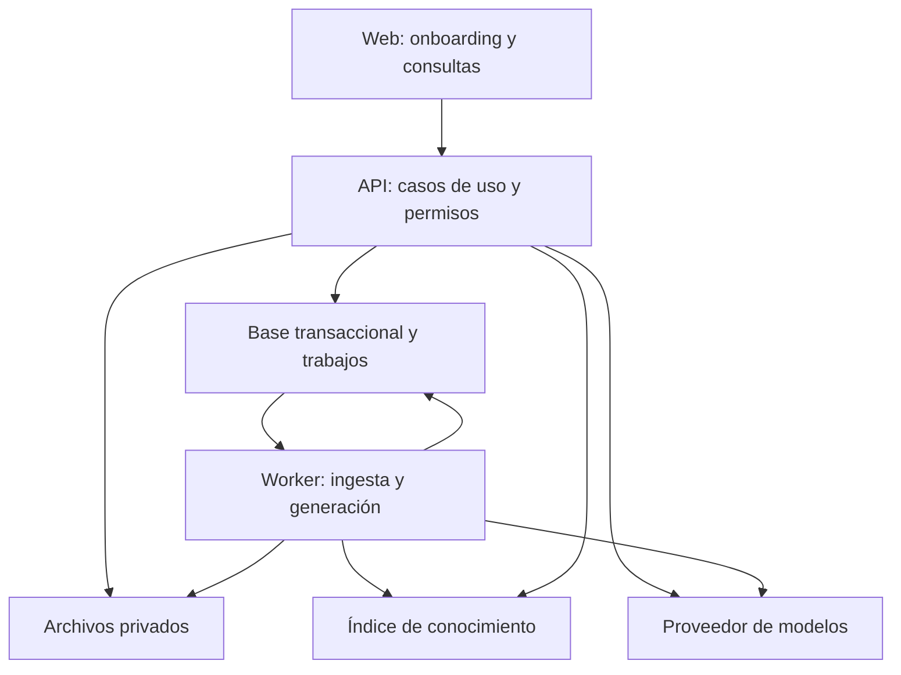
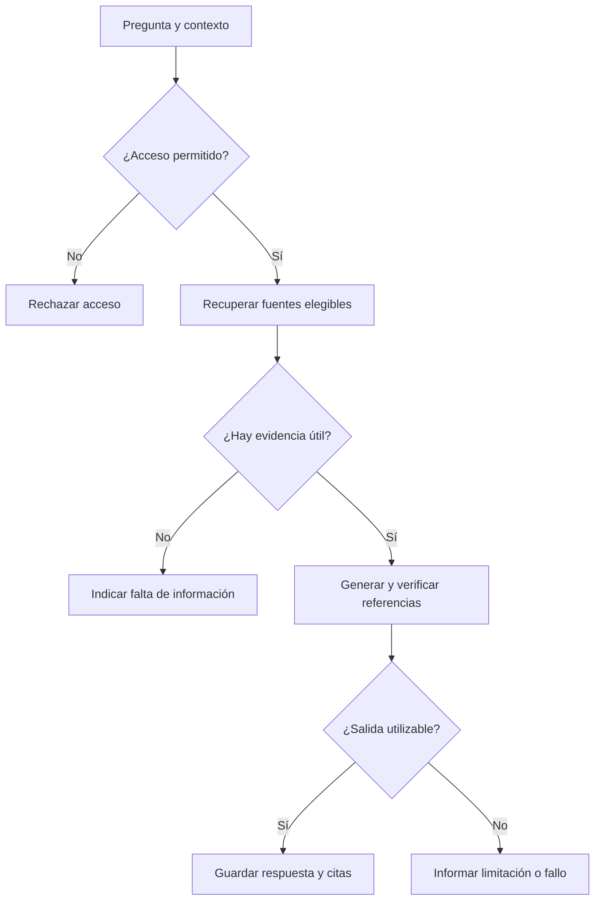

# Arquitectura inicial de Stepable V0

Estado: arquitectura, stack e identidad local aprobados; acceso por espacio, servicios externos y piloto pendientes. Versión v0.7.
Actualizado: 2026-09-17 · Decisiones relacionadas: [ADR-002](decisiones/ADR-002-organizacion-modular.md) y [ADR-003](decisiones/ADR-003-stack-y-acceso-e1.md).

## 1. Objetivo y fundamento

Proponemos una aplicación organizada por módulos, con una API y un proceso de trabajo en segundo plano que comparten código de negocio. La web es su interfaz inicial. Los módulos no se despliegan como servicios independientes: API y worker son dos formas de ejecutar una misma aplicación backend.

Esta organización fue aceptada para desarrollo local el 2026-09-17, basada en un desarrollador, un piloto todavía no confirmado y la necesidad de mantener reglas coherentes entre fuentes, rutas y progreso. No es una conclusión de validación comercial o de rendimiento.

Separar responsabilidades lógicas no exige separar servidores. Microsoft documenta esta distinción y el aislamiento de reglas respecto a infraestructura; se utiliza como referencia conceptual, sin elegir .NET o Azure. [Microsoft: arquitecturas web](https://learn.microsoft.com/en-us/dotnet/architecture/modern-web-apps-azure/common-web-application-architectures).

## 2. Componentes en ejecución

Las flechas representan acceso o dependencia operativa, no eventos emitidos automáticamente por la base. El worker reclama trabajos persistidos mediante un mecanismo por elegir. El índice puede estar en la misma base o en almacenamiento especializado; el dibujo no prescribe otro servidor.

| Componente | Responsabilidad | Límite |
| --- | --- | --- |
| Web | Pantallas, formularios, progreso y chat | No decide permisos ni guarda claves de proveedores |
| API | Autorización, casos de uso, consultas y guardado de resultados | No procesa documentos largos dentro de una solicitud |
| Worker | Extraer, indexar y generar borradores | Reutiliza reglas del backend y revalida vigencia del trabajo |
| Base transaccional | Estado del negocio, miembros, versiones, intentos y trabajos | Fuente de verdad de permisos y publicación |
| Archivos privados | Originales y versiones de documentos | Acceso autorizado, no enlaces públicos permanentes |
| Índice | Encontrar fragmentos candidatos | No es autoridad de permisos ni copia única del conocimiento |
| Modelos | Embeddings y generación de contenido | No publican rutas ni autorizan operaciones |

Web/API comparten la aplicación Next.js durante E1 y el worker se incorpora desde E2. Para desarrollo local se usa Supabase Auth; su uso alojado y la infraestructura del piloto no están decididos. No se contratan servicios.

## 3. Módulos y propiedad

| Módulo | Es propietario de | Interacciones permitidas |
| --- | --- | --- |
| Acceso | Espacios, membresías y roles | Expone comprobaciones de acceso a todos los casos de uso |
| Fuentes | Documentos, versiones, texto y fragmentos | Expone versiones elegibles y ubicaciones de citas |
| Conocimiento | Recuperación, integración con modelos y validación de salida | Consulta fuentes autorizadas; devuelve resultados, no publica |
| Rutas | Borradores, pasos y versiones publicadas | Solicita generación a conocimiento y valida referencias de fuentes |
| Aprendizaje | Intentos, calificaciones y progreso | Lee una versión publicada y sus criterios |
| Conversaciones | Hilos y mensajes privados | Solicita respuestas a conocimiento con contexto autorizado |
| Operación | Trabajos, consumo y diagnóstico | Coordina ejecución; no contiene reglas de aprendizaje |

Cada módulo modifica sus propios datos. Los casos de uso coordinan colaboraciones mediante funciones o interfaces internas explícitas. No usar llamadas HTTP entre módulos del mismo backend ni permitir que uno modifique tablas de otro como atajo.

## 4. Organización interna del código

La estructura física se decidirá al elegir lenguaje. Dentro de una funcionalidad se distinguirán:

- Entrada: endpoint o manejador de trabajo que valida forma de la solicitud.
- Caso de uso: autoriza y coordina la operación, por ejemplo publicar una ruta.
- Reglas: condiciones como inmutabilidad de versión publicada o pertenencia al espacio.
- Adaptadores: base de datos, archivos, correo, extracción y modelos.

No se requiere una interfaz por cada clase. Se crean fronteras explícitas donde hay efectos externos o reglas que interesa verificar de forma independiente. La interfaz web no importa detalles del proveedor de IA y el worker no duplica reglas de publicación.

## 5. Fuentes y procesamiento

Flujo propuesto:

1. La API autoriza al responsable, valida tipo y límite del archivo y registra la carga.
2. Guarda el archivo privado. Una vez confirmado, persiste versión y trabajo pendiente. Un fallo entre almacenamiento y registro requiere limpieza de cargas huérfanas; no se presume transacción distribuida.
3. El worker reclama el trabajo, verifica que la fuente no esté retirada y extrae texto con página o sección.
4. Genera fragmentos y embeddings; escribe resultados bajo una versión de indexación identificable.
5. Solo al completar el procesamiento marca la versión como lista. Las consultas descartan índices incompletos o referencias no elegibles.
6. Si falla, conserva un estado de error recuperable. Un reintento no crea otra versión documental por accidente.

Estados de trabajo propuestos: pendiente, ejecutando, completado, fallido. La elegibilidad documental es separada: una tarea completada no hace vigente una fuente retirada. Límites de intentos y cancelación quedan en PEN-08/PEN-04.

El mecanismo de trabajos debe recuperar una ejecución interrumpida, por ejemplo mediante una reserva con vencimiento. Su contrato debe tolerar procesamiento repetido: registrar el resultado una sola vez por trabajo lógico, aunque el proveedor externo pudiera haber cobrado más de un intento.

## 6. Consulta con evidencia

El identificador de espacio enviado por el navegador no prueba pertenencia. Se verifica usuario, espacio, hilo y, si existe, versión de lección. La búsqueda filtra por espacio y elegibilidad antes de enviar fragmentos al modelo; las referencias se comprueban nuevamente contra las fuentes autorizadas.

La comprobación estructural de citas y la revisión de respaldo son controles distintos. No se garantiza verdad por pasar una validación de formato. El conjunto de evaluación del [documento 06](06-ia-y-evaluacion.md) debe medir respaldo y suficiencia.

Por V0, chat y generación de rutas son operaciones explícitas en la interfaz. No necesitamos un agente autónomo que adivine si debe generar una ruta a partir de cualquier mensaje. Los conectores MCP no son una dependencia del chat.

## 7. Generar, revisar y publicar

1. El responsable elige objetivo, fuentes y actividades.
2. La API registra el trabajo con las versiones seleccionadas. No sostiene una transacción abierta mientras espera al modelo.
3. El worker recupera material elegible y pide un borrador estructurado.
4. Valida tipos de actividad, campos y referencias; guarda un borrador con su procedencia.
5. El responsable revisa y edita contenido, respuestas y explicaciones.
6. La API comprueba rol, versión editada y referencias antes de publicar. Un conflicto de edición se informa en lugar de sobrescribir cambios.

La publicación crea una versión estable. El modelo no recibe credenciales que le permitan publicarla. Cambios de fuente durante una generación deben detectarse: propuesta inicial, conservar el borrador con advertencia y exigir revisión antes de publicar. Esta política se debe cerrar en PEN-04.

## 8. Aprendizaje y calificación

El backend entrega la actividad sin revelar la clave antes de responder. Al enviar una respuesta, valida pertenencia, versión y criterio; guarda intento y progreso de forma coherente. Un doble envío de la misma acción debe devolver el mismo resultado, no contar como dos intentos.

La clave y la explicación se entregan cuando corresponda al feedback. Ocultarlas en el frontend no sustituye este control. La lógica de aprobación se resuelve en PEN-03. La IA puede explicar una regla; no ejecuta código ni redefine criterios durante la calificación.

## 9. Almacenamiento y versiones

Propuesta: una base relacional para el estado principal, almacenamiento privado para archivos y un índice reconstruible desde texto/versiones conservados. El motor y la ubicación del índice están pendientes. No elegir una base vectorial independiente hasta evaluar si la persistencia principal cubre el piloto.

Referencias persistentes deben incluir espacio, fuente, versión y ubicación; rutas e intentos mantienen versiones explícitas. La política de qué versión usa el chat frente a una lección antigua queda pendiente: no hacer mezclas silenciosas.

Bases, archivos y versiones requieren un plan de copia y restauración antes de recibir documentación real del piloto. No se han definido retención ni garantías de recuperación.

## 10. Permisos y límites de confianza

Controlar acceso en cada operación y denegar cuando no exista permiso explícito es la referencia de diseño; esconder botones no autoriza recursos. [OWASP: Authorization](https://cheatsheetseries.owasp.org/cheatsheets/Authorization_Cheat_Sheet.html).

Aplicar controles también a descarga de fuentes, citas, historial y tareas en segundo plano. No enviar documentos de otro espacio al modelo para después ocultarlos en pantalla. Contenido recuperado se trata como datos, no como instrucciones de sistema, y se evita que pueda activar acciones privilegiadas. [OWASP: seguridad de RAG](https://cheatsheetseries.owasp.org/cheatsheets/RAG_Security_Cheat_Sheet.html).

Chats privados se rigen por RN-04. Registros operativos guardan por defecto identificadores, duración, resultado y consumo, no prompts o documentos completos. Definir acceso operativo, retención y proveedor antes del piloto. Renderizar Markdown generado con restricciones para impedir contenido activo no deseado.

## 11. Fallos, consumo y observabilidad

| Caso | Respuesta prevista |
| --- | --- |
| Parser o embeddings fallan | Fuente no elegible, error visible y reintento acotado |
| Worker reinicia | Recuperar trabajos abandonados sin duplicar el resultado lógico |
| Modelo no responde | Estado de error y mensaje claro; no inventar una respuesta |
| Fuentes cambian | Detectar versiones y aplicar política PEN-04 |
| Dos editores guardan | Detectar conflicto de versión |
| Límite de IA alcanzado | Rechazar nuevas operaciones costosas con explicación |
| Usuario pierde acceso | Revalidar operaciones siguientes y entrega de resultados |

Reservar consumo estimado antes de llamadas concurrentes y reconciliarlo con el uso reportado evita que varias solicitudes ignoren el mismo límite. Los valores y la política ante timeouts requieren definición; no se promete un tope exacto de facturación externa por esta reserva.

Correlacionar solicitud, trabajo y llamada de proveedor. Registrar intentos, errores y uso; medir latencia antes de prometer umbrales. No se necesita fijar todavía una plataforma completa de observabilidad.

## 12. Alternativas y evolución

| Alternativa | Evaluación para Stepable |
| --- | --- |
| Toda la operación dentro de solicitudes web | Menos procesos, pero ingesta/generación largas requieren recuperación fuera de la solicitud |
| Aplicación modular y worker del mismo backend | Propuesta base: reglas compartidas y trabajos persistentes con responsabilidades delimitadas |
| Microservicios por módulo | Añade coordinación distribuida y despliegues que el piloto aún no justifica |

La separación propuesta permite agregar tipos de actividad y adaptadores de fuentes más adelante. No garantiza que futuras integraciones sean triviales: permisos y sincronización requerirán diseño propio. Separar un servicio solo cuando haya evidencia de escala, carga o mantenimiento que lo justifique.

## 13. Qué queda para resolver

ADR-002 y el stack local de ADR-003 están aceptados. PEN-02/PEN-05 conservan las reglas de acceso pendientes; PEN-07 conserva jobs, búsqueda, IA y servicios alojados; PEN-01 requiere precisar la operación/costo del piloto. PEN-04/PEN-06/PEN-08 cubren versiones, privacidad y límites antes de las entregas afectadas.

E1.1 fue autorizada, implementada y verificada localmente. Su aprobación no autorizaba por sí sola E1.2; la identidad local recibió autorización separada después. Ninguna de ambas autoriza despliegue o gastos.

## 14. Restricción económica incorporada en v0.3

Presupuesto indicado por el usuario: aproximadamente 10 USD mensuales para primeras pruebas, entendido como total al responder la pregunta sobre presupuesto mensual. No presupone cargos autorizados.

Propuesta de planificación: validar primero los flujos localmente y estimar por separado el piloto accesible a terceros. En local, registrar consumo de embeddings y generación si se usan APIs de pago; los recursos propios también tienen costos como electricidad, aunque no impliquen contratar hosting. No suponer que alojamiento, almacenamiento, correo e IA cabrán todos en 10 USD sin comparar precios y límites vigentes.

Antes de seleccionar proveedores: definir una carga de prueba (documentos, tamaño, preguntas y rutas), calcular consumo aproximado, verificar precios oficiales y reservar margen. Usar respuestas simuladas para desarrollo funcional y un conjunto acotado de llamadas reales para evaluar IA. Las simulaciones no cuentan como validación de calidad del modelo. Los controles de consumo internos no sustituyen límites del proveedor ni garantizan un máximo exacto facturado.

## 15. Revisión para iniciar E1

Decisión aceptada: **monolito modular en código, ejecución mínima por etapa**. Web y API comparten un proceso en E1; el ejecutable de worker se incorpora cuando E2 tenga trabajos largos. Esto conserva una sola implementación de reglas. No implica convertir módulos en microservicios ni ejecutar tareas largas dentro de una solicitud cuando estas existan.

La separación normativa queda así:

- `web`: presentación y adaptación HTTP; nunca es autoridad de permisos.
- `acceso`, `fuentes`, `conocimiento`, `rutas`, `aprendizaje`, `conversaciones`: módulos de aplicación con reglas y datos propios.
- `worker`: otro punto de entrada al mismo código de aplicación, activado desde E2.
- adaptadores de PostgreSQL, autenticación, archivos, correo y modelos: sustituibles en los límites donde existe un servicio externo.

Para E1, el único módulo funcional es acceso. No se crearán esqueletos exhaustivos de módulos futuros: basta con una estructura que no obligue a poner reglas de autorización en componentes de React o manejadores HTTP.

## 16. Stack local

Estado: **aceptado e implementado para E1.1**. Versiones exactas fijadas en `package.json` y `pnpm-lock.yaml`: Node 24, pnpm 11.23.0, Next.js 16.3.5, React 19.3.0, TypeScript 5.9.3, Zod 4.6.5, Drizzle 0.45.2, Vitest 5.0.1 y Playwright 1.63.0. TypeScript 7 y ESLint 10 se descartaron al detectar incompatibilidades declaradas por los plugins de lint; se fijaron TypeScript 5.9.3 y ESLint 9.39.5.

| Área | Recomendación | Motivo y consecuencia |
| --- | --- | --- |
| Lenguaje y repositorio | TypeScript estricto, Node.js LTS y workspace `pnpm` | Un solo lenguaje para web, API y worker; reduce cambio de contexto. El dominio no dependerá de React ni del SDK de un proveedor. |
| Frontend y API | Next.js con App Router; Route Handlers como adaptador HTTP | Permite una aplicación desplegable en E1, renderizado web y endpoints cuando sean necesarios. Server Actions no sustituyen casos de uso ni autorización. |
| Validación | Zod en fronteras de entrada y configuración | Esquemas explícitos y reutilizables; no reemplaza restricciones de base. |
| Persistencia | PostgreSQL, Drizzle ORM para acceso tipado y migraciones SQL canónicas de Supabase CLI | Relacional encaja con membresías, unicidad e integridad. Habrá un solo historial de migraciones en `supabase/migrations`; no una segunda base o motor de migración de Drizzle. |
| Autenticación local | Supabase Auth mediante adaptadores `@supabase/ssr`/`supabase-js` | E1.2 implementa correo/contraseña, sesión y recuperación local. El proveedor alojado, espacios y política completa de acceso siguen pendientes. |
| Archivos | Pendiente de E2/piloto | E1.1 no usa Storage ni MinIO; se elegirá sin duplicar servicios innecesarios. |
| Trabajos | Propuesta pendiente: `pg-boss` sobre PostgreSQL y ejecutable Node separado desde E2 | La activación del worker está aceptada para E2, pero la biblioteca de cola se validará al iniciar esa entrega. |
| Correo local | Mailpit incluido en Supabase CLI | Captura sin envío real. Correo externo y proveedor quedan pendientes del piloto. |
| Pruebas | Vitest para unidades/integración y Playwright para recorridos web | Pirámide pequeña: reglas rápidas, PostgreSQL real para autorización y pocos recorridos críticos. |
| Observabilidad | Logs estructurados con identificador de solicitud y métricas de consumo propias | Suficiente para piloto; no se contrata una plataforma adicional en E1. |

No se recomienda usar el cliente de Supabase desde el navegador como vía general de datos. El navegador usa el flujo de sesión; los casos de uso pasan por la aplicación y vuelven a comprobar membresía y rol. RLS se mantiene como defensa adicional en tablas expuestas, no como sustituto de pruebas de autorización. La clave administrativa de Supabase permanece solo en servidor.

## 17. Entorno local y piloto

### Local reproducible

Decisión aceptada e implementada en E1.1: usar **una sola pila local de Supabase CLI 2.117.0**, que contiene PostgreSQL, Auth y Mailpit. No levantar otro PostgreSQL ni otro Mailpit. Storage está presente como parte de la versión instalada, pero E1 no lo usa; archivos, worker e IA no se ejecutan localmente todavía.

Requisitos verificados:

- Node.js LTS, Corepack/`pnpm` y Supabase CLI como dependencia de desarrollo del proyecto;
- runtime compatible con la API de Docker en ejecución;
- puertos locales configurados por Supabase y enlazados a `127.0.0.1`; la pila nunca se expone a Internet;
- variables locales en archivo ignorado por Git y un ejemplo versionado solo con nombres/valores no secretos.

Flujo diario implementado:

1. `pnpm env:start`: envoltorio documentado de `supabase start`; inicia Postgres, Auth y Mailpit.
2. `pnpm dev`: inicia únicamente la aplicación Next.js contra la instancia local.
3. `pnpm db:reset`: aplica desde cero el único historial SQL de `supabase/migrations` y semillas no sensibles.
4. `pnpm env:status`: muestra URLs locales, incluida la bandeja de Mailpit.
5. `pnpm env:stop`: envoltorio de `supabase stop`; detiene la pila sin añadir servicios duplicados.

La verificación, recuperación e invitaciones se prueban generando correos de Auth y de Stepable contra el SMTP de Mailpit incluido. Los recorridos manuales abren los enlaces en su bandeja web; las pruebas automatizadas consultan su interfaz local y no Internet. No se desactiva la confirmación de correo para simular éxito.

E1.2 configura Auth con registro público bloqueado y proveedor de correo habilitado para login/recuperación. La sesión vive en cookies administradas por `@supabase/ssr`; una página protegida llama `getUser()` en servidor, no confía solo en estado del navegador. Un script Node obtiene la capacidad administrativa exclusivamente desde el estado local de Supabase, solicita credenciales interactivamente y crea una identidad confirmada sin asignar privilegios de producto. La clave administrativa no usa prefijo `NEXT_PUBLIC_` ni se importa desde `src/`.

La recuperación usa una plantilla local con token hash y un callback servidor. El callback verifica el token una sola vez, fija la cookie en una respuesta intermedia no cacheable y navega después a la pantalla de contraseña; esto evita trasladar sesiones por fragmentos de URL y permite que el navegador confirme la cookie antes de la siguiente solicitud. Mailpit conserva el mensaje para la comprobación manual. Espacios, membresías, roles e invitaciones no forman parte de este flujo.

La documentación oficial indica que Supabase CLI ofrece PostgreSQL, Auth y otros servicios locales, requiere CLI más runtime de contenedores y captura los correos locales automáticamente con Mailpit. [Desarrollo local](https://supabase.com/docs/guides/local-development) y [contraseñas/Auth local](https://supabase.com/docs/guides/auth/passwords).

- Archivos en MinIO solo desde E2 si sigue siendo necesario; IA simulada por defecto hasta E3/E4.
- Migraciones aplicadas desde cero y datos de prueba sin información empresarial real.

El desarrollo local no tiene cuota mensual de proveedor por defecto. Electricidad, equipo e Internet existen pero no se contabilizan como contratación de Stepable. Las llamadas reales de IA serán opt-in, medidas y con presupuesto separado.

### Piloto pendiente

Correo externo, dominio de aplicación/envío, alojamiento, proveedores y costos de despliegue quedan expresamente fuera de esta etapa. La investigación v0.4–v0.5 se conserva en el historial, pero ninguna alternativa quedó elegida. Antes del piloto se volverán a verificar precios, límites, backups, retención y requisitos de envío; el presupuesto orientativo sigue siendo aproximadamente 10 USD/mes. No contratar ni desplegar por inferencia a partir de la base local.

## 18. Búsqueda e IA posteriores, sin implementación en E1

Mantener estas opciones dentro de PostgreSQL para el primer piloto:

1. búsqueda léxica con `tsvector`/`tsquery` para términos exactos, nombres de API y símbolos;
2. búsqueda semántica con `pgvector` y embeddings;
3. combinación híbrida y reranking solo si el conjunto de evaluación demuestra beneficio;
4. filtros obligatorios por espacio, versión y elegibilidad antes de generar;
5. proveedor de generación detrás de un adaptador con salida estructurada, medición de tokens/costo y posibilidad de cambiar de modelo.

Supabase ofrece `pgvector` en PostgreSQL y documenta índices HNSW/IVFFlat; no se propone una base vectorial separada para el volumen esperado del piloto. [Columnas vectoriales](https://supabase.com/docs/guides/ai/vector-columns) e [índices](https://supabase.com/docs/guides/ai/vector-indexes). La elección de modelo y sus precios se verifica al planear E2/E3, porque cambian y todavía faltan PEN-06, PEN-08 y la carga de evaluación. E1 no instala SDKs de IA ni hace llamadas a modelos.
